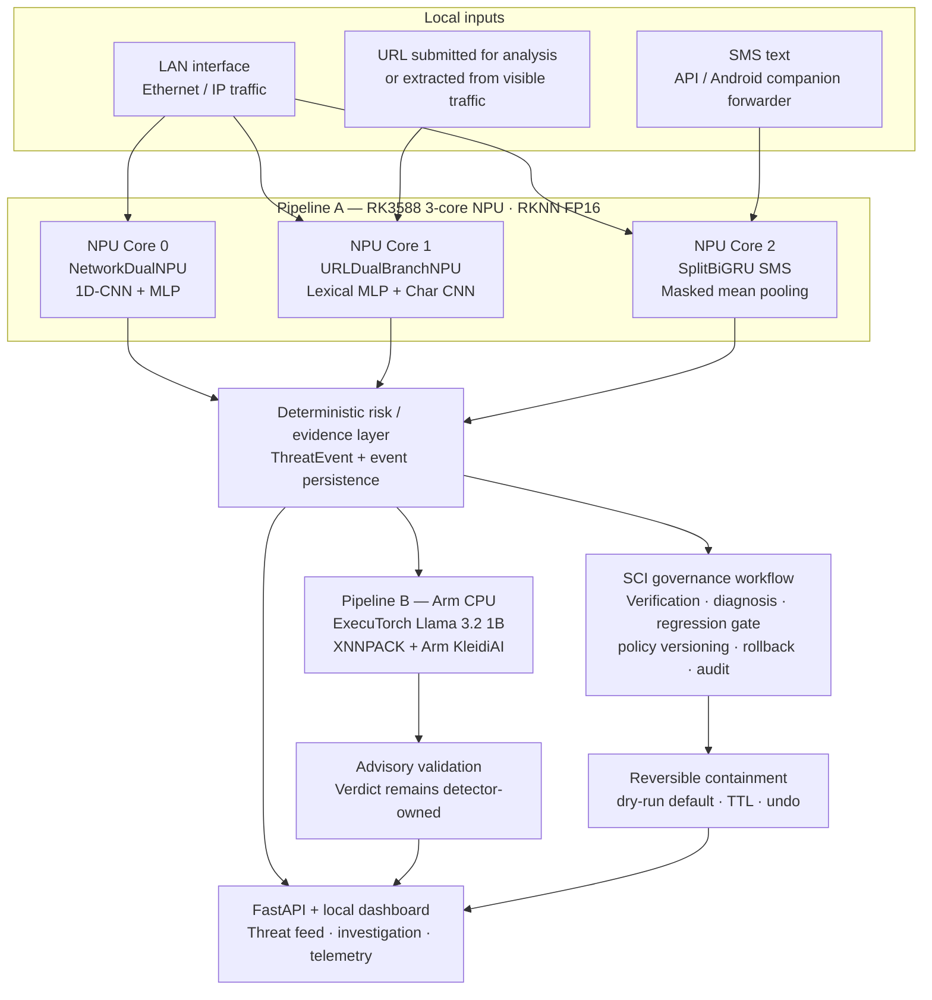

<div align="center">

# EdgeShield AI

### On-Device Threat, Phishing & Scam Detection for the Arm Edge

**Bharat AI-SoC Challenge 2026–27 · Problem Statement 3**  
**Team EdgeProc**

[](#target-platform)
[](#dual-pipeline-architecture)
[](#dual-pipeline-architecture)
[](#privacy-and-operational-boundaries)

**One edge gateway. Three specialist threat detectors. One evidence-driven security workflow.**

EdgeShield AI is an Arm64 edge-security gateway that brings network intrusion detection, phishing URL analysis and scam-SMS detection together on a Rockchip RK3588J platform. Three dedicated FP16 neural detectors are mapped to the SoC's three NPU cores. A separate on-device Llama runtime on the Arm CPU can explain an already-computed finding, while a common event and risk layer, analyst dashboard, SCI governance workflow and reversible containment controls help operators investigate and respond locally.

</div>

---

## At a glance

| What | EdgeShield AI |
|---|---|
| Challenge scope | PS3 — on-device threat, phishing and scam detection |
| Target device | Rockchip RK3588J Arm64 Linux system-on-module / custom board |
| Detection acceleration | RK3588 3-core NPU using RKNN FP16 models |
| NPU Core 0 | Network IDS — 1D-CNN + MLP |
| NPU Core 1 | Phishing URL — lexical MLP + character 1D-CNN |
| NPU Core 2 | Scam SMS — split BiGRU + masked pooling |
| Local advisory | Llama 3.2 1B through ExecuTorch, XNNPACK and Arm KleidiAI on the Arm CPU |
| Backend and interface | FastAPI service, local web dashboard, event persistence and hardware telemetry |
| Governance and response | 9-stage Self-Correcting Intelligence (SCI) workflow, policy versioning, SHA-256-linked audit records, dry-run-first reversible containment |
| Network visibility | Passive local-interface capture and flow / protocol feature extraction |
| Cloud dependency | No cloud service is required for the local detection and inference paths described here |

> **Important:** The RKNN detector artifacts are included in this source package. The large Llama `.pte` weights and tokenizer are intentionally distributed separately. Without those files, the application uses its deterministic template advisory provider; the detector pipeline does not depend on the Llama model being present.

## EdgeShield Design

| Design choice | What it means in this implementation |
|---|---|
| **Three detectors mapped to three NPU cores** | Network, URL and SMS inference use separate persistent RKNN workers pinned to `NPU_CORE_0`, `NPU_CORE_1` and `NPU_CORE_2`. |
| **Detection and explanation are separated** | The detection / risk path produces the threat verdict. Llama is an advisory component; it is not allowed to overturn the verdict or write detection policy. |
| **A gateway view across threat channels** | Network observations, URLs and SMS analyses flow into a common event / risk presentation and dashboard, with correlation views for related activity. |
| **Real board evidence is part of the repository** | Raw JSON benchmark results, held-out detector metrics, red-team audit output, regression evidence and board screenshots are included. |
| **Response is designed to be reversible** | Containment supports dry-run operation, finite lifetimes (TTL), protected-host safeguards and undo / audit records. |
| **Governance is part of the design** | SCI includes feedback verification, diagnosis, bounded correction planning, a Golden Suite regression gate, versioned policy deployment and rollback. |

## Visual overview

The following screenshots are included in `docs/img/screens/` and were captured from the RK3588J dashboard.

<p align="center">
  
  
</p>
<p align="center">
  
  
</p>
<p align="center">
  
  
</p>

*Screenshots: Command Center · Investigation and advisory · Threat Scanners · Correlation view · SCI / Containment · Arm SoC Monitor.*

---

## Dual-pipeline architecture

EdgeShield separates time-sensitive threat inference from natural-language explanation.



### Pipeline A — specialist detection on the RK3588 NPU

Each model is loaded by a persistent worker and assigned to a dedicated NPU core.

| NPU core | Security function | Model architecture | Model artifact |
|---|---|---|---|
| **Core 0**  | Network intrusion / anomalous-flow detection | `NetworkDualNPU`: 1D-CNN branch + MLP branch + fusion head; 26 flow features | `models/rknn/network_ids_fp16.rknn` |
| **Core 1**  | Phishing URL detection | `URLDualBranchNPU`: 25 lexical features + character 1D-CNN branch + fusion head | `models/rknn/url_hybrid_fp16.rknn` |
| **Core 2**  | Scam / smishing SMS detection | `SplitBiGRUExactPacked` + masked global mean pooling + weighted BCE training objective | `models/rknn/sms_bigru_fp16.rknn` and `sms_bigru_emb.npz` |

The model metadata and checksums are recorded in `models/rknn/manifest.json` and the associated `*_meta.json` files.

### Pipeline B — local threat explanation on the Arm CPU

- **Model:** Llama 3.2 1B, exported to ExecuTorch (`.pte`).
- **Runtime:** Native C++ runner using ExecuTorch with XNNPACK and Arm KleidiAI.
- **Role:** Produce a human-readable explanation and advisory steps using the threat event as context.
- **Guardrail:** The model is downstream of detection. It cannot change the detector's verdict or SCI policy.
- **Fallback:** If the `.pte` and tokenizer are absent, a deterministic template advisory provider is used.

The exported weights and tokenizer are large and are not included in this source archive. See [Adding the Llama model](#adding-the-llama-model-optional-large-artifacts).

## Target platform

| Item | Target |
|---|---|
| SoC | Rockchip RK3588J |
| CPU | Arm64, 4 × Cortex-A76 + 4 × Cortex-A55 |
| NPU | 3-core Rockchip NPU, advertised platform capability up to 6 TOPS |
| OS | Debian-based Arm64 Linux |
| NPU runtime | RKNN Toolkit Lite 2; benchmarked with Rockchip runtime 2.3.x |
| Model precision | FP16 RKNN deployment |
| Application runtime | Python / FastAPI plus native C/C++ components |
| Local advisory runtime | ExecuTorch / XNNPACK / Arm KleidiAI |

The board-specific deployment guide is in [`docs/BOARD_DEPLOYMENT_RK3588J.md`](source/edgeshield-ai/docs/BOARD_DEPLOYMENT_RK3588J.md).

---

## Measured results

The repository includes raw measurement records under [`benchmarks/results/`](source/edgeshield-ai/benchmarks/results/). The headline figures below are copied from those records and are identified by test type so that model evaluation, board throughput and adversarial testing are not confused with one another.

### RK3588J simultaneous NPU throughput

<badge>Physical RK3588J benchmark</badge>

| NPU core | Detector | Requests / second | NPU call p50 | NPU call p95 |
|---|---|---:|---:|---:|
| Core 0 | Network IDS | 200.77 | 0.643 ms | 1.232 ms |
| Core 1 | Phishing URL | 143.29 | 1.611 ms | 1.837 ms |
| Core 2 | Scam SMS | 71.77 | 8.653 ms | 9.102 ms |
| **Combined simultaneous load** | **All three cores** | **415.83 req/s** | — | — |

This is a four-second concurrent benchmark across the three NPU endpoints. It is an observed test result, not a guaranteed production throughput figure. See [`rk3588_3core_npu_concurrency.json`](source/edgeshield-ai/benchmarks/results/rk3588_3core_npu_concurrency.json).

### Held-out detector evaluation

| Detector | Evaluation set described in report | ROC-AUC | F1 / operating point | Additional reported metric |
|---|---|---:|---:|---|
| Network IDS | CIC-IDS2017 plus Edge-LAN flow data; 289,981 total flows in training/evaluation manifest | 1.0000 | 0.9985 @ 0.50 | Precision 0.9999; recall 0.9971; FPR 0.00% at 0.50 |
| Phishing URL | Domain-grouped phishing URLs and Tranco benign URLs; 160,000 rows in report | 0.9781 | 0.8291 @ 0.96 | Precision 0.9878; recall 0.7143; FPR 0.80% at 0.96 |
| Scam SMS | Deduplicated UCI SMS, LSDST-2022 and Indian scam / benign OTP data; 6,573 rows in report | 0.9942 | 0.9592 @ 0.50 | Precision 0.9447; recall 0.9741; FPR 1.39% at 0.50 |

**Thresholds matter.** The URL model's high-precision operating point (0.96) is different from its lower-threshold / cost-sensitive settings. The SMS detector's F1 figure is reported at 0.50; its cost-sensitive recall result uses a lower threshold (0.22). Metrics from different thresholds should not be compared as if they were the same operating point.

See [`detectors_heldout_metrics.json`](source/edgeshield-ai/benchmarks/results/detectors_heldout_metrics.json) and [`benchmarks/README.md`](source/edgeshield-ai/benchmarks/README.md).

### Local Llama sustained-run benchmark

| Measurement | Recorded result |
|---|---:|
| Consecutive advisory runs | 20 |
| Mean decode speed | 26.54 tokens/s |
| Median wall time | 3,449 ms |
| Maximum wall time | 5,456.5 ms |
| Peak big-core temperature | 84.1 °C |
| ExecuTorch process RSS before / after | 918.84 MB / 918.84 MB |
| RSS delta during this test | 0.00 MB |
| Test output validation | All 20 runs validated |

These are board test results for the particular model export, context configuration and test workload. They are not a universal latency or thermal guarantee. Raw evidence: [`llama_sustained_20run_thermal.json`](source/edgeshield-ai/benchmarks/results/llama_sustained_20run_thermal.json).

### System memory snapshot

A recorded board snapshot measured **1,278.25 MB total EdgeShield RSS**: 359.41 MB for the API / three NPU workers / live sniffer pipeline and 918.84 MB for the ExecuTorch Llama process. This is a measurement from the included system-memory benchmark, not a minimum hardware requirement. See [`system_memory_footprint.json`](source/edgeshield-ai/benchmarks/results/system_memory_footprint.json).

### Adversarial audit and regression evidence

| Test | Recorded outcome |
|---|---|
| Live-wire test waves | 10 attack scenarios; 468 packets sent; board event count increased by 114 |
| API adversarial suite | 160 cases total: 129 attack cases and 31 benign controls |
| Attack detection | 129 / 129 attack cases detected in that suite |
| Precision / F1 | 96.99% / 98.47% |
| Benign false positives | 4 / 31 controls (12.9% FPR) |
| Automated tests | 61 passed, 3 skipped |
| SCI ledger verification | Valid; 8 records checked in the recorded run |

**Interpretation:** The reported 100% attack recall applies to the 129 attack cases in this particular test suite. It does not mean zero false positives or universal detection. Four benign controls were flagged. Review the raw [`adversarial_redteam_audit.json`](source/edgeshield-ai/benchmarks/results/adversarial_redteam_audit.json) before interpreting the result.

---

## How threat analysis works

### Network intrusion and anomaly analysis

The passive monitor reads traffic visible on the selected local network interface. The native sniffer and flow-reduction path extract flow-level features for the Network IDS. The current design also extracts supported DNS, HTTP and SIP / mail-related signals where visible to the local monitor.

Examples of traffic behaviours that can be examined include port scans, connection bursts, suspicious destinations and flow anomalies. Exact visibility depends on what the interface can observe and what the protocol exposes.

### Phishing URL analysis

URLs supplied to the API or extracted from supported visible traffic are analysed using lexical and character-level signals by the hybrid URL detector. The detector's output is combined with the application risk and evidence layer.

An optional link sandbox component exists in the source tree. It is not required for offline lexical URL scoring and should be treated as a separate, opt-in capability with its own network and SSRF safety considerations.

### Scam SMS analysis

SMS content can be submitted through the local API. The hybrid SMS pipeline combines deterministic scam indicators and model evidence with the RKNN BiGRU inference path when the NPU worker is available.

**Cellular SMS is not passively visible on Ethernet.** To analyse messages received by a phone, use the Android companion / local webhook forwarder described in [`MOBILE_COMPANION.md`](source/edgeshield-ai/docs/MOBILE_COMPANION.md). It requires user-granted Android permissions and local connectivity to the gateway.

### Common event and risk layer

Detector outputs are normalised into a common threat-event representation containing fields such as event identifier, timestamp, source, threat category, severity, risk score, confidence, evidence, recommended actions and model version. The dashboard presents the event history and investigation context.

A risk score is a system score used to prioritise an event; it should not be interpreted as a calibrated probability of compromise.

---

## SCI governance and reversible response

The Self-Correcting Intelligence (SCI) workflow is organised into nine stages:

1. Threat detection from URL, SMS, network and live-monitor sources.
2. Decision and evidence logging with the current policy version.
3. Independent offline outcome verification, including an uncertainty state.
4. Root-cause diagnosis of verified detection errors.
5. Deterministic correction planning; LLM policy writes are disabled.
6. Bounded correction workflow and retraining hand-off where needed.
7. Golden Suite regression validation before policy changes.
8. Versioned policy deployment, rollback and SHA-256-linked audit records.
9. Post-deployment policy-version monitoring.

### Reversible containment

The containment implementation includes a dry-run-first response path with finite TTLs, protected-host safeguards and undo support. The provided deployment configuration includes nftables integration and DNS sinkhole-related mechanisms.

**Containment is not automatically enabled as an enforcement guarantee.** Review the environment, firewall rules, protected-host configuration and dry-run mode before any live enforcement. Use only on systems and networks you own or are authorised to administer.

The recorded SCI / regression evidence is available in [`sci_and_regression_proof.json`](source/edgeshield-ai/benchmarks/results/sci_and_regression_proof.json).

---

## Quick start

### 1. Requirements

For the hardware-accelerated configuration:

- Rockchip RK3588J Arm64 Linux board with a supported RKNPU driver and runtime.
- Debian-based Arm64 Linux environment.
- Python 3.10 or newer for the main application.
- A separate Python 3.11 environment with `rknn-toolkit-lite2` compatible with the board runtime.
- Build/runtime dependencies for the included native binaries if you need to rebuild them.
- A local browser on the board or another trusted LAN machine.

The application can start on a non-RK3588 development host using the available fallback path, but RKNN inference requires compatible Rockchip hardware and runtime.

### 2. Install the Python application dependencies

```bash
cd EdgeShield_AI_v1.3.0/source/edgeshield-ai

python3 -m venv .venv
. .venv/bin/activate

python -m pip install --upgrade pip
pip install -e ".[dev]"
```

### 3. Install the RKNN Lite runtime

Create a separate Python 3.11 environment for the NPU workers. For example, with Miniforge / Conda:

```bash
conda create -n rknn-python python=3.11 -y
conda activate rknn-python
pip install numpy rknn-toolkit-lite2==2.3.2
```

Set the path to that interpreter in the main environment:

```bash
export EDGESHIELD_RKNN_PYTHON="$HOME/miniforge3/envs/rknn-python/bin/python"
```

Use the RKNN Lite package and runtime versions compatible with your installed Rockchip driver. The versions above reflect the project's tested configuration; they are not a promise of compatibility with every vendor image.

### 4. Restore packet-capture capabilities

ZIP extraction does not preserve Linux file capabilities. On the target board:

```bash
sudo setcap cap_net_raw,cap_net_admin=eip bin/live_sniffer
```

If `setcap` is unavailable, install the relevant system package (`libcap2-bin` on Debian-family systems). Do not run packet-capture tests on networks for which you do not have authorisation.

### 5. Start EdgeShield

```bash
./run.sh
```

Useful commands:

```bash
./run.sh status
./run.sh logs
./run.sh fg
./run.sh restart
./run.sh stop
```

The launcher starts the API and local dashboard on port `8000` by default. It also starts the configured NPU worker and monitor processes as available.

### 6. Open the dashboard

On the board:

```text
http://127.0.0.1:8000
```

From a trusted machine on the same LAN:

```text
http://<BOARD_LAN_IP>:8000
```

Do not expose the service directly to the public internet. Configure API authentication and host firewall rules before allowing access from other devices.

---

## Verify the service and run sample analyses

### Health and subsystem status

```bash
curl -s http://127.0.0.1:8000/api/health
curl -s http://127.0.0.1:8000/api/hardware/rknn/status
curl -s http://127.0.0.1:8000/api/network/monitor/status
curl -s http://127.0.0.1:8000/api/sci/pipeline/status
```

### Analyse a phishing URL

```bash
curl -s -X POST http://127.0.0.1:8000/api/url/analyze \
  -H 'Content-Type: application/json' \
  -d '{"url":"https://example.com/security-check"}'
```

### Analyse a scam SMS

```bash
curl -s -X POST http://127.0.0.1:8000/api/sms/analyze \
  -H 'Content-Type: application/json' \
  -d '{"message":"Urgent: Your bank account will be blocked. Complete KYC immediately at https://example.com"}'
```

### Analyse a network flow

```bash
curl -s -X POST http://127.0.0.1:8000/api/network/analyze \
  -H 'Content-Type: application/json' \
  -d '{
    "flows": [{
      "src_ip": "192.168.1.50",
      "dst_ip": "192.168.1.6",
      "dst_port": 22,
      "protocol": "tcp",
      "packets": 60,
      "bytes": 5400,
      "syn_packets": 55,
      "failed_connections": 24,
      "duration_seconds": 1.5
    }]
  }'
```

The values above are synthetic demonstration inputs. They do not target a real external service.

---

## Adding the Llama model (optional large artifacts)

The Llama model is intentionally not included in this source submission because the exported `.pte` file is hundreds of megabytes and the tokenizer is also a large artifact. The detection models required by the three RK3588 NPU workers are distributed separately in `models/rknn/`.

To enable the ExecuTorch advisory pipeline, place the matching exported model and tokenizer in `models/` using the paths expected by the launcher:

```bash
# Example filenames; use the matching model export and tokenizer pair.
cp /path/to/llama_3_2_1b_xnnpack_ctx512.pte models/llama.pte
cp /path/to/tokenizer.json models/tokenizer.model
```

Then ensure the native runner is executable and restart the service:

```bash
chmod +x bin/executorch_runner
./run.sh restart
./run.sh status
```

The actual model and tokenizer must be a compatible pair. Do not rename an unrelated `.pte` file or tokenizer and assume they are interchangeable.

If the model files are absent, the application uses the built-in deterministic template advisory backend. This fallback is expected behaviour and does not indicate that Llama inference is running.

See [`scripts/export_llama_executorch.sh`](source/edgeshield-ai/scripts/export_llama_executorch.sh) for the model export workflow and [`docs/TECHNICAL_REPORT_v1.4.md`](source/edgeshield-ai/docs/TECHNICAL_REPORT_v1.4.md) for the recorded configuration and performance results.

---

## Android companion: forwarding cellular SMS

EdgeShield is a Linux gateway. Cellular messages received by an Android phone do not automatically traverse the gateway's Ethernet interface.

For the companion workflow, connect the phone and RK3588J gateway to the same trusted LAN and configure the Android-side forwarder with the required permissions:

```bash
python3 scripts/android_sms_forwarder.py --gateway <BOARD_LAN_IP> --port 8000
```

A local automation tool such as Tasker or MacroDroid can also send an HTTP POST to:

```text
http://<BOARD_LAN_IP>:8000/api/sms/analyze
```

with a JSON body containing the message. Review [`docs/MOBILE_COMPANION.md`](source/edgeshield-ai/docs/MOBILE_COMPANION.md) for details.

This integration is permission-based forwarding after message receipt; it is not silent interception of cellular SMS.

---

## Repository structure

```text
EdgeShield_AI_v1.3.0/
├── README.md                         # Project overview and challenge submission entry point
├── run.sh                            # Package-level launcher
├── docs/                             # Top-level architecture and planning documents
└── source/
    └── edgeshield-ai/
        ├── app/
        │   ├── detectors/             # SMS, URL, network and live-monitor logic
        │   ├── edge_models/           # RKNN clients, workers and model integration
        │   ├── advisory/              # ExecuTorch command adapter and template fallback
        │   ├── sci/                   # SCI governance, validation and containment
        │   ├── events.py              # Threat event contracts and event handling
        │   ├── risk.py                # Risk scoring / aggregation
        │   └── static/                # Local web dashboard
        ├── models/
        │   ├── rknn/                  # Three RK3588 FP16 detector models + metadata
        │   └── *.joblib               # Classical ML / fallback artifacts
        ├── benchmarks/
        │   ├── README.md
        │   └── results/               # Raw benchmark and audit JSON records
        ├── docs/
        │   ├── img/screens/            # RK3588J dashboard screenshots
        │   ├── DEMO.md
        │   ├── MOBILE_COMPANION.md
        │   ├── BOARD_DEPLOYMENT_RK3588J.md
        │   └── TECHNICAL_REPORT_v1.4.md
        ├── native/                    # C++ native runtime / API baseline
        ├── src/                       # Native sniffer and ExecuTorch runner source
        ├── bin/                       # Included Arm64 helper binaries
        ├── scripts/                   # Training, export, build and benchmark scripts
        ├── deploy/                    # Service and nftables deployment examples
        └── tests/                     # Python test suite
```

---

## Documentation and evidence

| Resource | What it contains |
|---|---|
| [Technical engineering report (PDF)](source/edgeshield-ai/docs/EdgeShield_AI_Technical_Report_v1.4.pdf) | System design, model architectures, hardware partitioning, board results and limitations |
| [Technical report (Markdown)](source/edgeshield-ai/docs/TECHNICAL_REPORT_v1.4.md) | Text version of the engineering report |
| [Benchmark guide](source/edgeshield-ai/benchmarks/README.md) | Test methods and reported metrics |
| [Raw benchmark results](source/edgeshield-ai/benchmarks/results/) | JSON measurements from the board |
| [Demo runbook](source/edgeshield-ai/docs/DEMO.md) | Suggested live demonstration flow |
| [Board deployment guide](source/edgeshield-ai/docs/BOARD_DEPLOYMENT_RK3588J.md) | RK3588J bring-up and deployment notes |
| [Mobile companion guide](source/edgeshield-ai/docs/MOBILE_COMPANION.md) | Android SMS forwarding |
| [SCI engine design](source/edgeshield-ai/docs/SCI_ENGINE_DESIGN.md) | Governance and correction pipeline design |
| [Model manifests](source/edgeshield-ai/models/rknn/manifest.json) | Model metadata, target core and artifact hashes |

### Reproduce the benchmarks

On the RK3588J board, after installing the matching runtime and dependencies:

```bash
cd source/edgeshield-ai
python3 scripts/run_benchmarks.py
```

This command is intended to reproduce the hardware and model evidence described in the benchmark guide. Run it on the target hardware for comparable results; desktop or emulated measurements are not substitutes for NPU-board measurements.

### Run the automated tests

```bash
cd source/edgeshield-ai
pytest -q
```

The included recorded test result is 61 passed and 3 skipped. Your local result may differ with Python, package, model and hardware/runtime versions.

---

## Privacy, security and operational boundaries

- **Local-first processing:** the detection and advisory design is intended to run locally; no cloud service is required for the described on-device pipeline.
- **Encrypted traffic:** passive interface monitoring can observe flow metadata and protocol information that is visible on the interface. It cannot inspect the contents of TLS-encrypted sessions or DNS-over-HTTPS payloads without a separate interception mechanism; EdgeShield does not claim to decrypt those sessions.
- **SMS boundary:** cellular SMS needs explicit phone-side forwarding to the gateway. The gateway does not silently intercept messages from a phone.
- **LLM boundary:** the language model is an advisory component. It is not the detector, does not own the risk verdict and is not permitted to write SCI detection policy.
- **Containment boundary:** dry-run is the default safety posture in the provided design. Live enforcement should be enabled only after validating the firewall, TTL, protected-host and rollback behaviour on an authorised test network.
- **API exposure:** the application can bind to all interfaces for LAN access. Configure `EDGESHIELD_API_TOKEN`, host firewall rules and a trusted network boundary before exposing mutating endpoints. The token is optional and must be explicitly configured.
- **Model/data caveats:** benchmark metrics are tied to the datasets, split methods, thresholds and device/runtime configurations recorded in the repository. They should not be interpreted as a guarantee of real-world detection rates.

## Configuration

The principal runtime settings include:

| Variable | Purpose |
|---|---|
| `EDGESHIELD_RKNN_PYTHON` | Python interpreter containing RKNN Lite dependencies for NPU workers |
| `EDGESHIELD_EXECUTOR` | Advisory provider selection (`command` for ExecuTorch runner; `template` for deterministic fallback) |
| `EDGESHIELD_EXECUTOR_COMMAND` | Path to the native ExecuTorch runner |
| `EDGESHIELD_EXECUTOR_MODEL_PATH` | Path to the Llama `.pte` model |
| `EDGESHIELD_EXECUTOR_TOKENIZER_PATH` | Path to the matching tokenizer |
| `EDGESHIELD_EXECUTOR_DAEMON` | Whether the advisory runner remains resident |
| `EDGESHIELD_LIVE_MONITOR_ENABLED` | Enable or disable passive NIC monitoring |
| `EDGESHIELD_LIVE_MONITOR_INTERFACE` | Interface selected for monitoring |
| `EDGESHIELD_DB_PATH` | SQLite event / SCI database path |
| `EDGESHIELD_API_TOKEN` | Optional API token for protected operations |
| `EDGESHIELD_PORT` / `EDGESHIELD_HOST` | API bind address and port |

See [`.env.example`](source/edgeshield-ai/.env.example) for the supplied configuration template.

---

## Challenge alignment

| PS3 capability area | EdgeShield implementation |
|---|---|
| On-device scam detection | Hybrid SMS analysis with RKNN BiGRU inference on NPU Core 2 |
| Phishing detection | Lexical and character-level URL model on NPU Core 1 |
| Threat / network anomaly detection | Flow-feature Network IDS on NPU Core 0, plus passive local-interface monitoring |
| Arm-based acceleration | Three dedicated RK3588 NPU worker processes |
| Local AI assistance | ExecuTorch Llama 3.2 1B advisory on the Arm CPU when the separate model files are provisioned |
| Operator visibility | Local web dashboard, evidence and event history, SoC telemetry |
| Response and governance | SCI workflow, policy versioning / rollback, audit ledger and reversible containment controls |

## Known limitations

1. Passive capture is limited to traffic visible to the chosen network interface. TLS, QUIC and DoH encryption limit payload-level visibility.
2. Cellular SMS requires an Android companion forwarder or an explicit local webhook; it is not passively captured from the mobile network by the gateway.
3. The optional link sandbox is a separate capability and is not part of the mandatory offline URL lexical-inference path.
4. The adversarial audit included four benign false positives among 31 benign cases. Further calibration and broader benign traffic evaluation are important.
5. The reported throughput and model metrics are measured under the included test conditions; they do not guarantee identical performance on a different RK3588 board, kernel, runtime or thermal environment.
6. Llama model weights and tokenizer are excluded from the source ZIP. Without the matching files, the deterministic template advisory fallback is used.
7. Some SoC utilization counters depend on kernel / driver exposure and may not be available on every vendor image.

---

## License and third-party components

Review the repository's `LICENSE` and third-party notices before redistribution. The repository uses components and model assets with their own licenses and terms, including Rockchip RKNN runtime components, ExecuTorch, XNNPACK, Arm KleidiAI and Meta Llama model assets. The applicable upstream licenses and model terms remain in force.

---

<div align="center">

**EdgeShield AI — Detection at the edge. Explanations on-device. Response under operator control.**

</div>
