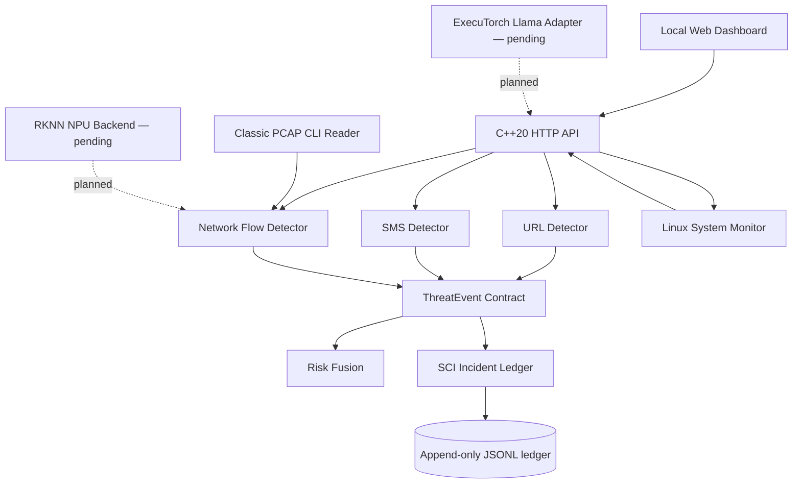

# EdgeShield AI v1.3.0 — Native Runtime Notes

## Runtime topology

## Component contracts

- `ThreatEvent`: common source/category/severity/evidence/actions/risk/confidence contract.
- `ITextDetector`: independent URL/SMS detector interface.
- `NetworkDetector`: consumes normalized `NetworkFlow` records.
- `PcapReader`: extracts Ethernet/IPv4 TCP/UDP flow aggregates from classic PCAP.
- `RiskFusion`: combines multiple risk scores; does not reinterpret confidence as probability.
- `SciEngine`: records diagnosis/correction recommendations and caller verification status.
- `SystemMonitor`: reads Linux procfs/sysfs/statvfs telemetry. Missing values remain unavailable.

## SCI integrity notes

The ledger links each record checksum to the previous checksum. SHA-256 is used when CMake finds OpenSSL. The fallback build is marked `NONCRYPTO-*`; it is not a cryptographic integrity mechanism. A hash chain does not prove factual correctness, trusted time, or resistance to a privileged attacker who can rewrite the entire ledger.

## EdgeBLE RK3588J validation checklist

- [ ] `uname -m` reports `aarch64`.
- [ ] `cmake --build build -j2` completes on the board.
- [ ] `ctest --test-dir build --output-on-failure` passes.
- [ ] `./build/edgeshieldd monitor` reports CPU, RAM and storage.
- [ ] Dashboard health endpoint returns `status=ok`.
- [ ] URL/SMS known-positive and known-negative test cases are recorded.
- [ ] A known-good classic PCAP is processed; compare packet/flow counts with a trusted analyser.
- [ ] Offline Llama + ExecuTorch model generation is demonstrated with exact model/runtime versions.
- [ ] NPU utilisation is shown only if a real driver counter is read and validated.
- [ ] Benchmark methodology, warm-up, repetitions, input corpus and board thermal state are documented.

## Security boundary

The server is an engineering/demo service. It does not authenticate users, encrypt transport or automatically block traffic. Bind to loopback by default. Do not expose on an untrusted network.
